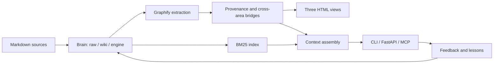

# Altair Brain

A local knowledge engine for AI assistants. You keep notes and source documents in Markdown folders; Altair Brain indexes them, links them into a graph with traceable sources, and serves the result to an AI client through a CLI, a FastAPI service or an MCP server.

[](https://github.com/Simus100/altair-brain/actions/workflows/validate.yml)


The engine does no language-model reasoning of its own. It retrieves, ranks and cites; the AI client that queries it does the thinking. Rebuilding a brain needs no paid API.


*Screenshot of a generated page. The data is synthetic: 3 areas, 18 source notes, 18 curated pages. None of it ships with the starter brain.*

## What it does

- **Keeps knowledge apart from code.** The engine exists once, versioned in `VERSION`. Each brain is a folder of knowledge with a manifest that records which engine version last rebuilt it. One engine can serve several brains.
- **Traces every page to its sources.** Curated pages in `wiki/` link back to the raw documents in `raw/` they were written from, and those links are edges in the graph. `tools/check_provenance.py` flags figures and dates in reports that have no source.
- **Searches text as well as structure.** Graphify answers questions about nodes and relationships. A BM25 index in plain Python covers the prose, including `.txt` notes the graph does not see. Semantic search is optional and runs locally.
- **Handles facts that expire.** A note can carry `valid_until` and `superseded_by`. Expired facts are demoted in search results, and a date parameter returns what was true on that day.
- **Builds context within a budget.** `brain_context` returns ranked excerpts, deduplicated by file, plus graph neighbours and relevant lessons, cut to a token budget the caller chooses.
- **Learns only from checkable evidence.** A lesson becomes a rule only if it names something outside the model's own prose: a test, an error, a measurement, a user correction. Everything else stays a dated observation. The rule digest has a size cap.

## How it works



`python tools/rebuild_all.py` runs the whole pipeline in one pass. It first checks that this engine version can rebuild the brain, then validates the contracts, extracts the graph, prunes engine code out of it, applies bridges and provenance, and regenerates subgraphs, views, the search index, the lesson digest and the health metrics. It stops at the first step that fails.

The graph stores relationships and citations. Confidence labels in search results describe the retrieval signal, not whether a statement is true.

## Design decisions

| Problem | What the engine does |
|---|---|
| Personal notes mixed into application code | Brains live in their own folders; the local registry and every installed brain are ignored by Git |
| A copied engine drifts from the original | Brains carry no code. Compatibility is checked by semantic version; `brain_export.py` bundles the matching engine when a brain must run elsewhere |
| Hard-to-verify knowledge | Front-matter, provenance edges, explicit cross-area bridges and JSON Schema contracts for every brain file |
| A graph alone retrieves too little prose | BM25 over the full text; optional embeddings fused with Reciprocal Rank Fusion |
| Context grows with every conversation | Excerpts instead of whole files, a token budget, a capped lesson digest |
| Several clients need the same functions | One core module behind the CLI, the HTTP API and the MCP server |
| Generated files silently diverge | One rebuild command, regression tests, and a check that the extended view matches the final graph |
| An optional module becomes a hard dependency | AION is a separate package; CI runs the full suite with and without it |

## Quick start

Requirements: Git, Python 3.12 or later, and Graphify 0.9.2 (the version this release is tested against).

```bash
git clone https://github.com/Simus100/altair-brain.git
cd altair-brain
python -m venv .venv
source .venv/bin/activate            # Windows: .\.venv\Scripts\Activate.ps1
python -m pip install -r server/requirements.txt
python -m pip install graphifyy==0.9.2 jsonschema pytest httpx
python tools/brain.py                # prints the active brain: brains/starter on a fresh clone
python tools/rebuild_all.py
```

Open `brains/starter/graphify-out/index.html`. The starter is empty: it contains the folder structure, an empty lesson registry and no training.

To create your own brain:

```bash
python tools/brain_new.py --nome research --aree sources,methods
export ALTAIR_BRAIN=brains/research  # Windows: $env:ALTAIR_BRAIN = 'brains/research'
python tools/rebuild_all.py
```

Put source documents in `raw/<area>/` and curated pages in `wiki/<area>/`, inside the brain folder. `[[wikilinks]]` resolve within the same folder; links between areas are declared in `engine/bridges.json`. The pipeline indexes what you write. Turning a raw document into a good curated page is still editorial work, yours or an AI client's.

Brain selection follows a fixed order: the `ALTAIR_BRAIN` variable, then the active entry in the local `brains/brains.json`, then the public default. Details in [brains/README.md](brains/README.md).

### AION (optional)

Add `--training aion` when creating a brain to install AION, a structured reasoning protocol with its reference texts and an executable I Ching oracle. It changes the instructions an AI client follows; it does not fine-tune any model. A brain can adopt at most one training, and none is the default.

## Connecting an AI client

| Interface | Entry point | Notes |
|---|---|---|
| CLI | `tools/search.py`, `tools/context_pack.py`, `graphify query` | Runs locally, no server |
| MCP | `server/mcp_server.py` | Tools: `brain_query`, `brain_search`, `brain_context`, `brain_explain`, `brain_path`, `brain_lessons`, `brain_feedback`; with AION also `brain_model`, `brain_reasoner`, `brain_oracle` |
| HTTP | `server/app.py` | FastAPI under `/v1`, Bearer token, per-IP rate limit, OpenAPI schema for ChatGPT Actions |

Endpoints, deployment with Caddy and systemd, and backups are documented in [server/README.md](server/README.md).

## Three views of the graph

| View | Use it to |
|---|---|
| **3D atlas** | Find your way around an unfamiliar area. Height is the process layer, the slice is the area, distance from the axis is connectivity |
| **Extended graph** | Inspect one node and every relationship declared on it |
| **Compact view** | Explain the system as a five-stage process: sources, model, engine, skills, feedback |

<details>
<summary>Extended and compact views</summary>


</details>

The atlas is hand-written Canvas 2D with perspective projection. It has no dependencies and opens offline from `file://`; `tests/test_atlas.py` checks its layout rules. The extended and compact views load external visualization libraries. Positions in the atlas encode layer, area and connectivity, not causality.

## Verified status

| Check | Result |
|---|---:|
| Tests on a clean clone, no training | 137 passed, 119 skipped |
| Tests on a clean clone, AION adopted | 191 passed, 68 skipped |
| Notes and lessons shipped in the starter | 0 |
| Paid API calls needed to rebuild | 0 |
| Synthetic screenshot graph | 144 nodes, 219 relationships |

Skipped tests need a corpus, a training or a plugin that is not installed; they are not counted as verified. The [verification record](docs/VERIFICATION.md) gives the environment and method. `python docs/generate_demo.py` regenerates the screenshot corpus. The demo graph is not a capacity benchmark, and nothing here measures the quality of AI answers.

## Known limits

- The API has one token. It grants read access and administrative operations alike; separate reader and admin credentials are one of the next priorities.
- Rebuild and update write files in place. There is no atomic switch to a validated release yet, and no per-brain lock.
- No load test has been run on large corpora.
- Cloning the repository deploys nothing. The API requires explicit configuration and HTTPS.

Defects found and work still open are listed in the [architecture audit](AUDIT_SISTEMA_2026-10-04.md) and the [roadmap](ROADMAP.md).

## Repository layout

```text
tools/       engine and lifecycle commands
server/      FastAPI app, MCP server, deployment scripts
schema/      JSON Schema contracts for brain files
tests/       regression tests and synthetic fixtures
training/    optional AION package
core/        standalone distribution, generated by tools/build_core.py
brains/      the empty starter; installed brains stay local
docs/        screenshots, demo generator, verification record
```

The day-to-day user guide, in Italian, is [GUIDA.md](GUIDA.md).

## Authorship and credits

Designed and built by [Simus100](https://github.com/Simus100), with AI coding assistants writing much of the code. My part was the architecture, the requirements, the integration and the validation: separating engine from data, defining the contracts, tracing knowledge to sources, testing the failure cases and making the build reproducible.

Graph extraction and traversal come from [Graphify](https://github.com/safishamsi/graphify). Altair Brain is the system around it: multi-brain management, provenance, retrieval, context assembly, serving and the compact and atlas views.

Earlier commits in this repository's history contain populated brains. Removing them from the current tree does not remove them from old commits, forks or existing clones.

Released under the [MIT License](LICENSE).
