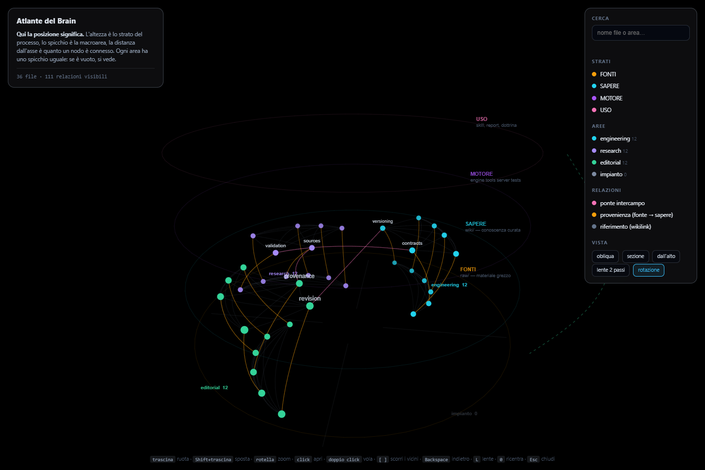
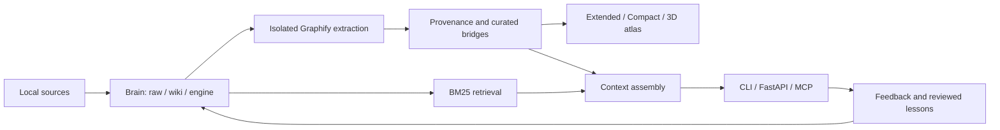
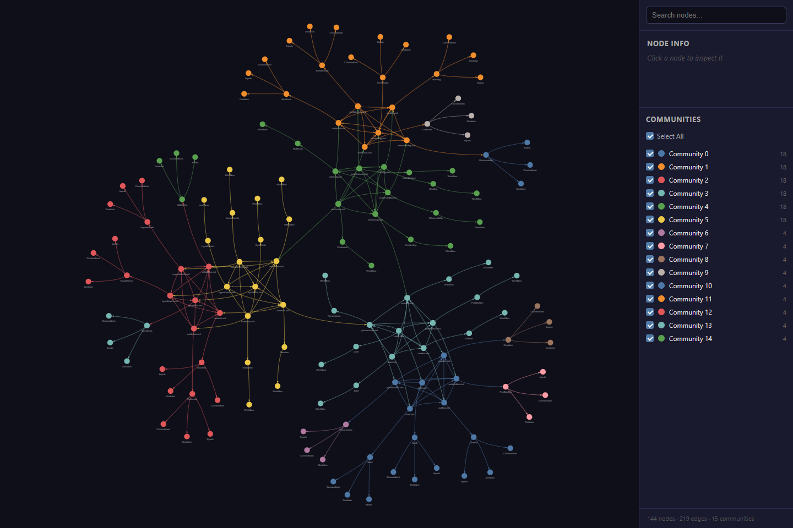
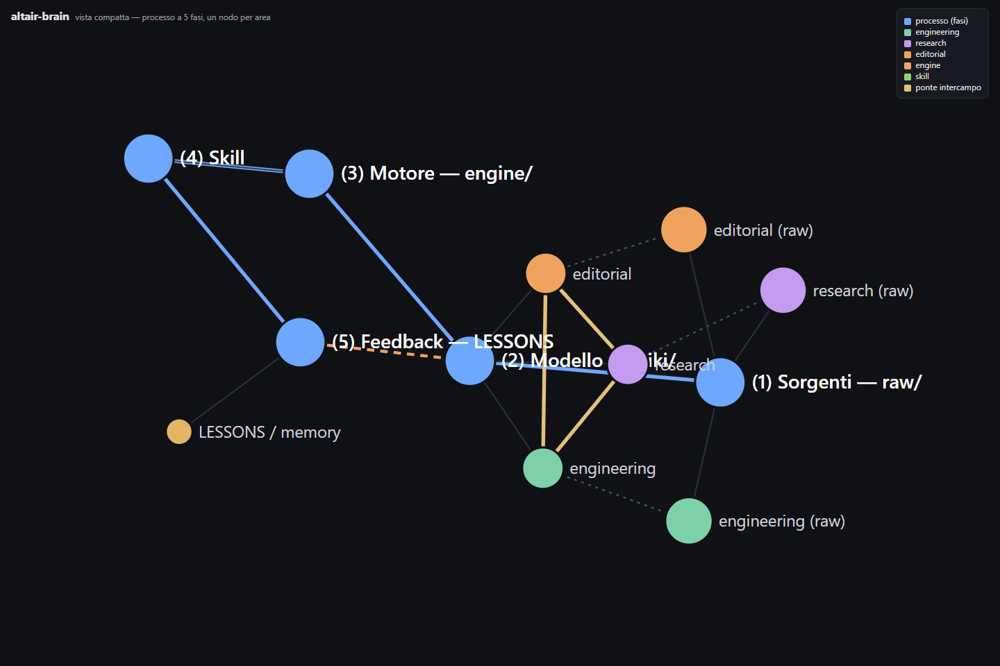

# Altair Brain

**A local-first knowledge engine for AI assistants. One engine, independent brains, traceable knowledge.**

**Un motore di conoscenza locale per assistenti AI: più brain indipendenti, fonti tracciabili e memoria organizzata.**

[](https://github.com/Simus100/altair-brain/actions/workflows/validate.yml)


Altair Brain turns folders of source material into organized, searchable knowledge that an AI client can inspect through a CLI, FastAPI or MCP. It combines lexical retrieval with an explicit graph of relationships, provenance, scoped context and reviewed experience.

The public distribution starts **virgin**: no acquired notes, no personal memory, no installed personal brains. AION is an optional reasoning protocol, selected during onboarding. No paid API is required for the core pipeline; an AI client supplies its own reasoning.


*Real product screenshot using synthetic demonstration data: three areas, 18 source notes and 18 curated pages. The installed starter contains none of these demonstration notes.*

## Why I built it

AI assistants need reusable knowledge that survives individual conversations. I designed Altair Brain to make that knowledge inspectable, portable and independent of the model consuming it.

This is a portfolio project by **[Simus100](https://github.com/Simus100)**, developed with AI coding assistants. My work focuses on the architecture, product requirements, integration and validation: separating engine and data, defining contracts, tracing knowledge to sources, testing failure cases and making the product reproducible.

The contribution is the system around **[Graphify](https://github.com/safishamsi/graphify)**. Graphify provides extraction and graph navigation; Altair Brain adds multi-brain lifecycle management, provenance, retrieval, context assembly, serving and three complementary views. Upstream work remains credited rather than presented as original code.

## Engineering decisions

| Problem | Implementation |
|---|---|
| Personal knowledge mixed with application code | One versioned engine; local brain folders and an ignored local registry |
| Knowledge that is difficult to verify | Source links, explicit bridges, front-matter and JSON Schema contracts |
| A graph alone cannot retrieve enough prose | Dependency-light BM25 search; optional semantic retrieval with corpus fingerprint checks |
| Context grows with every conversation | Ranked excerpts, deduplication, estimated context budgets and bounded lesson summaries |
| Several clients need the same capabilities | Shared core behind FastAPI and MCP, alongside CLI tools |
| Generated artifacts silently diverge | Rebuild pipeline, regression tests and checks matching the extended view to the final graph |
| An optional module becomes a hidden dependency | Separate AION package; onboarding and tests with training enabled or absent |



The graph stores relationships and citations. The consuming AI interprets them. Confidence labels describe retrieval signals, not a guarantee that a statement is true.

## Three ways to explore

| View | Best used for |
|---|---|
| **3D atlas** | Orienting across areas and layers, inspecting files and their neighborhoods |
| **Extended graph** | Inspecting individual nodes and all declared relationships |
| **Compact process view** | Understanding the five-stage knowledge workflow |

<details>
<summary>See the extended and compact views</summary>




</details>

The atlas uses Canvas with perspective projection, without WebGL or a CDN. The other two views currently use external visualization libraries. The 3D layout encodes process layer, area and connectivity; its positions do not imply causality.

## Start with a virgin brain

Prerequisites: Git, Python 3.12+ and Graphify **0.9.2**, the integration version currently verified here. Commands below use PowerShell; on Linux/macOS activate with `source .venv/bin/activate`.

```powershell
git clone https://github.com/Simus100/altair-brain.git
cd altair-brain
python -m venv .venv
.\.venv\Scripts\Activate.ps1
python -m pip install -r server/requirements.txt
python -m pip install graphifyy==0.9.2 jsonschema pytest httpx
python tools/brain.py                         # brains/starter on a fresh clone
python tools/rebuild_all.py
```

Open **`brains/starter/graphify-out/index.html`** to inspect the empty template. It contains structural documentation, an empty lesson registry and no adopted training.

Create your own independent brain:

```powershell
python tools/brain_new.py --nome research --aree sources,methods
$env:ALTAIR_BRAIN = 'brains/research'
python tools/rebuild_all.py
```

Add Markdown sources under the selected brain's `raw/<area>/` and curated pages under `wiki/<area>/`. Connect related concepts using `[[wikilinks]]` within the same folder; declare cross-area bridges explicitly. The pipeline indexes structure and text; distilling a raw document into a good curated page still requires editorial work or an AI client.

To adopt AION at creation, add `--training aion`. This installs a reasoning protocol and its reference material; it does not fine-tune model weights. Leave it out for a neutral starting point.

Your brain folders and `brains/brains.json` stay local by default. An explicit `ALTAIR_BRAIN` takes precedence over the local registry; the public default is used only when that registry is absent. See [brain storage and selection](brains/README.md).

## Measurable scope

| Metric | Current distribution |
|---|---:|
| Clean-clone tests, no training | **137 passed / 119 skipped** |
| Clean-clone tests, AION adopted | **191 passed / 68 skipped** |
| Acquired notes shipped in the starter | **0** |
| Acquired lessons shipped in the starter | **0** |
| Generated graph views | **3** |
| Training configurations verified | **2** — absent / AION |
| Synthetic screenshot graph | **144 nodes / 219 relationships** |
| Required paid API calls for rebuilding | **0** |

## Evidence and limits

The [verification record](docs/VERIFICATION.md) records the measured test results and their scope. The synthetic screenshot corpus is reproducible with `python docs/generate_demo.py`; its graph metrics are recorded alongside the screenshots. Demonstration graph size is not a capacity benchmark or an accuracy claim.

Current capabilities include version compatibility checks, schema validation, temporal retrieval, provenance, capture without filename collisions, feedback preservation and three generated views. The [architecture audit](AUDIT_SISTEMA_2026-10-04.md) documents defects found and remaining work.

For production use, the next priorities are separate reader/admin credentials, atomic publication of rebuilt artifacts, and load testing with larger corpora. The current API token authorizes the entire served brain, including administrative operations. API deployment requires explicit configuration and HTTPS; cloning the repository does not deploy a public service.

## Repository map

```text
tools/       shared engine and lifecycle commands
server/      FastAPI, MCP and deployment helpers
schema/      machine-readable contracts
tests/       regression tests and synthetic fixtures
training/    optional AION reference package
core/        generated standalone distribution
brains/      virgin starter; other installed brains stay local
docs/        screenshots, demonstration generator and verification evidence
```

- [API and deployment](server/README.md)
- [Everyday usage](GUIDA.md)
- [Engineering roadmap and handoff](ROADMAP.md)
- [License](LICENSE)

Existing published Git history may contain earlier populated brains. Their removal from the current distribution does not erase previous commits, forks or downloaded copies.

---

**Built by Simus100 with AI-assisted development.** Graph extraction and traversal powered by Graphify. MIT licensed.
